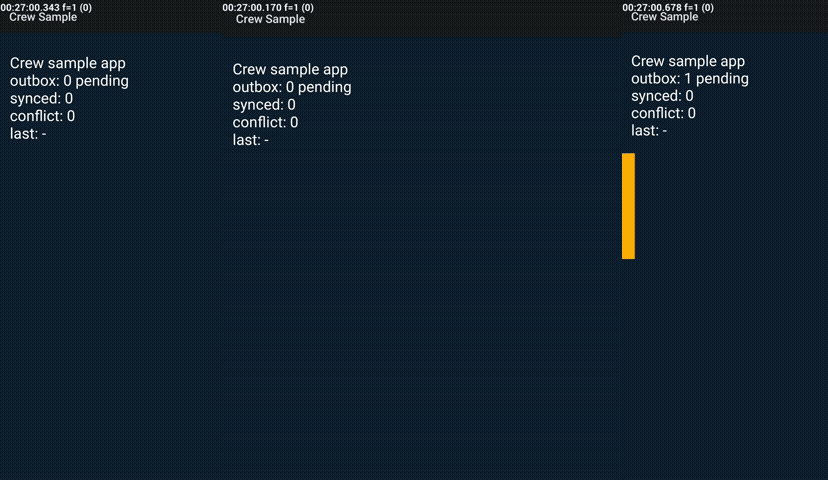

# crewdroid

[](https://www.npmjs.com/package/crewdroid) [](https://registry.modelcontextprotocol.io/v0/servers?search=crewdroid) [](LICENSE)

**Headless Android device lab for AI agents.** Boot a fleet of mixed Galaxy emulators in one command, break each one's network on its own schedule, replay the same user flow at different timings, then judge the server data for concurrency bugs — duplicate, missing or overwritten records. No window, no clicking: every step is a CLI command with `--json` and an exit code, and the same commands are MCP tools and agent skills.

```bash
npx crewdroid up --count 3        # 3 devices: s24ultra/API 34, fold5/API 34, flip7/API 36 — booted in ~7 s each
npx crewdroid run scenarios/photo-upload.json --seed 1   # multi-user flow + network chaos + judge, exit 1 on a bug
```



## Why not just the Android Emulator?

The stock emulator is one phone with a window, driven by hand. crewdroid is a *fleet* driven by a program.

| | Android Emulator / AVD Manager | crewdroid |
|---|---|---|
| Devices | one AVD = one window, one disk image each | N read-only clones of one base image, mixed screens (S/Fold/Flip/any `WxH@dpi`) and API levels, one command |
| Interaction | click in a window, read a screenshot | `--json` output + exit code on every command; `screen` returns the accessibility tree instead of pixels |
| Boot | 31.6 s cold | 6.7 s from a slim snapshot |
| Disk | 24.7 GiB (3 AVDs) | 6.99 GiB (3 clones, 3 API levels) |
| Host RAM | 8.45 GB | 3.93 GB |
| Idle CPU (100 % = 1 core) | 1000 % | ~600 % |
| Network | one toggle in Extended Controls | per-device `airplane`, `nodata`, `slow`, `flaky` on a randomised schedule, mid-upload |
| Multi-user bugs | not a feature | `run` repeats a flow on every device at different timings, then `judge` checks the server: `unique`, `count`, `noLostUpdate` |
| Device state | GUI panels | `env` (GPS, battery, rotation, dark mode, font, locale, GSM, SMS, calls) and `app` (permissions, deep links, Doze, trim, full storage) — each setter reads its state back |
| Fold / Flip | needs a foldable AVD | `fold` / `unfold` on any clone: the app gets a real configuration change |
| For an AI agent | nothing to call | MCP server, `AGENTS.md`, 7 skills triggered by symptoms ("app crashed", "deep link does not open", "sync duplicated a row") |

Numbers measured on one Windows 11 PC (Ryzen 7 5700X, 64 GB, WHPX), 3 devices, against 3 stock `google_apis` AVDs. Raw JSON and method in [`docs/measurements/`](docs/measurements/).

No barrier, by design. Real concurrency bugs come from retries, offline queues and late edits overlapping — not from pressing a button at the exact same millisecond. crewdroid gives each device its own delays and network schedule and lets the overlap happen, then reads the truth from the server ([ADR 0002](docs/adr/0002-no-barrier.md)).

## 60-second tour

Boot a mixed fleet (headless, nothing appears on screen):

```bash
$ crewdroid up --count 3 --json
[
  { "serial": "emulator-5580", "profile": "s24ultra",   "api": 34, "screen": "1080x2340@450", "bootSeconds": 6.4, "readySeconds": 42.1 },
  { "serial": "emulator-5582", "profile": "fold5-main", "api": 34, "screen": "1812x2176@420", "bootSeconds": 6.7, "readySeconds": 41.8 },
  { "serial": "emulator-5584", "profile": "flip7-main", "api": 36, "screen": "1080x2520@480", "bootSeconds": 3.1, "readySeconds": 39.9 }
]
```

Cut one device's data mid-upload, let another go flaky:

```bash
$ crewdroid net emulator-5580 nodata
$ crewdroid net emulator-5582 flaky
```

Run the multi-user scenario against a server with a race condition (`BUGGY=1` in the bundled sample server) and read the verdict:

```bash
$ crewdroid run scenarios/photo-upload.json --seed 1
...
VIOLATION uploads unique(key): duplicate key="u13-1" (2 rows)
VIOLATION uploads count(acks): missing 1 of 48 expected key values
VIOLATION writes noLostUpdate(id,baseVersion): lost update: 3 writes to id="r2" all based on baseVersion=4; all but one were overwritten
FAIL: 5 violations            # exit code 1
```

Same scenario, server fixed → `OK: 3 rules, 0 violations`, exit 0. The judge rules are a JSON file, so the same check runs against your own API's export.

Ask what is on screen without a screenshot:

```bash
$ crewdroid screen emulator-5580 --json
{ "focused": "dev.crewdroid.probe/.ProbeActivity",
  "tree": [ { "cls": "TextView", "text": "outbox: 1 pending", "bounds": [32,180,620,230], "clickable": false, "depth": 3 }, ... ] }
```

## Built for agents

- **Every command is machine-readable**: `--json`, non-zero exit on failure, read-back after every setter, clear error before any adb call on bad input.
- **MCP server**: `crewdroid mcp` exposes `devices`, `up`, `down`, `net`, `env`, `app`, `fold`, `triage`, `screen`, `perf`, `apk`, `judge`, `hammer`, `run` over stdio — the same functions the CLI calls, no second implementation.
- **Skills** in [`.agents/skills/`](.agents/skills/) (read by Claude Code, Cursor, Gemini CLI, Copilot, Codex): `crewdroid`, `android-triage`, `android-screen`, `android-permissions-intents`, `android-apk`, `android-perf`, `android-offline-concurrency`. Each is a short recipe of exact commands whose output the agent can act on.
- **`AGENTS.md`** with the rules an agent must keep (adb only against `emulator-<port>`, one run at a time, never a barrier) and **`CLAUDE.md`** for Claude Code.
- **Safe on a shared machine**: a USB phone plugged into the same PC is never touched; clones are read-only; `down` kills only `crew-*`.

```json
{ "mcpServers": { "crewdroid": { "command": "npx", "args": ["-y", "crewdroid", "mcp"] } } }
```

```bash
claude plugin marketplace add namyunsu/crewdroid && claude plugin install crewdroid@crewdroid
```

Cursor: [install the MCP server](cursor://anysphere.cursor-deeplink/mcp/install?name=crewdroid&config=eyJjb21tYW5kIjoibnB4IiwiYXJncyI6WyIteSIsImNyZXdkcm9pZCIsIm1jcCJdfQ==) · Codex / Gemini CLI / Copilot: the skills and `AGENTS.md` are picked up from the repo.

## What it finds

| Bug class | How crewdroid reproduces it | Rule that catches it |
|---|---|---|
| Duplicate upload after a retry (missing idempotency) | `flaky` network drops the response, the app's outbox retries with the same key | `unique(key)` |
| Dropped record (outbox lost on restart / airplane mode) | `airplane` during save, app restart offline, reconnect | `count(acks)` |
| Lost update (two users edit the same row, last write wins) | devices read the same version at different times and both PUT | `noLostUpdate(id,baseVersion)` |
| Fold during upload | `fold` / `unfold` while the outbox drains: the app must survive the configuration change with exactly one upload | `unique` + `count` |
| Crash / ANR only on one Android version or screen | mixed API 31/34/36 and S/Fold/Flip profiles in one run; `triage` reads the crash buffer, ANRs and exit reasons | — |

The bundled sample app (Kotlin, offline outbox, `probe-app/`) and sample server (`sample/server/`, `BUGGY=1` switch) make every row above reproducible on a laptop.

## Requirements

- Android SDK with command-line tools and emulator >= 36.4 (`ANDROID_SDK_ROOT` or `ANDROID_HOME` must point at it, or `~/.crewdroid/android-sdk` must exist). No SDK yet: `npx crewdroid setup --yes` installs JDK 17 (for sdkmanager only), command-line tools, platform-tools, emulator and the `google_atd` image (`--images 34,31,36`, `--dry-run` lists sizes first); crewdroid downloads the `google_atd` x86_64 images it needs (API 31/34/36, ~0.9 GB each) and shrinks them with `slim`
- Node >= 22
- Hardware acceleration: WHPX (Windows) or KVM (Linux)

## Commands

Every command takes `--json` and exits non-zero on failure.

| Command | What it does |
|---|---|
| `crewdroid up --count N [--profiles a,b] [--screen WxH[@dpi],...] [--profiles-file f.json]` | boot N emulators with Galaxy profiles or your own screens (any size, e.g. `--screen 3840x2160@320`) |
| `crewdroid down` | kill every `crew-*` emulator |
| `crewdroid net <serial> airplane\|nodata\|slow\|flaky\|online` | set one device's network state |
| `crewdroid fold <serial>` / `unfold <serial>` | cover <-> main screen on a Fold/Flip profile |
| `crewdroid run <scenario.json> [--seed N]` | run a multi-device scenario, then judge the server data |
| `crewdroid judge --rules <file> --source <url\|file>` | check unique / count / noLostUpdate rules |
| `crewdroid hammer --url <base>` | server-side concurrency load without devices |
| `crewdroid slim` / `prepare` / `identity` | shrink disk, build base AVDs, make devices distinct |
| `crewdroid measure --up N` | measure disk, RAM, boot, idle CPU |
| `crewdroid triage` / `screen` / `perf` / `apk` | Android diagnostics, see below |
| `crewdroid env <serial> <what> [args]` | device environment: location, battery, rotation, dark, font, locale, mobile network, SMS, calls (see Environment) |
| `crewdroid app <serial> <pkg> <what> [args]` | app control: permissions, deep links / App Links, data clear, backup / restore, resource pressure (see App control) |
| `crewdroid mcp` | stdio MCP server exposing the above to an agent |

## Diagnostics

Read-only commands (nothing stays running on the device). Each takes `--json`; the same four are MCP tools.

| Command | Output |
|---|---|
| `crewdroid triage <serial> [--app <pkg>] [--heap out.hprof]` | `crashes` (logcat crash buffer: pkg, exception, top frame in the app, time), `anrs` (ActivityManager log + `dumpsys activity exit-info`), `anrTraces` (`/data/anr` headers, or `"unreadable"` without root), `exits` (exit reasons), `recentLog` (the app's last 200 lines), `summary`. `--heap` runs `am dumpheap` and pulls the hprof. |
| `crewdroid screen <serial> [--png file]` | focused window (`dumpsys window`) and a compact `uiautomator` tree `[{cls, text, desc, id, bounds, clickable, depth}]`. Compose `testTag` shows as `id` only under `testTagsAsResourceId = true`. On API 31 a fully black screen left by an app relaunch (Android 12 emulator bug, any tool's `am start -S`) is recovered first (HOME + resume) and reported as `blackRelaunch`, so it is never mistaken for an app bug. |
| `crewdroid perf <serial> <pkg> [--activity .Main] [-- <am start extras>]` | cold start (`am force-stop`, 2 s, `am start -W`; TotalTime ms), frames / jank % / p50-p90-p99 from `dumpsys gfxinfo`, PSS total / Java / native KB from `dumpsys meminfo`. ATD images have no GPU: compare frame numbers between runs, not with a phone. |
| `crewdroid apk <file.apk>` | host only (`aapt2` from the newest `build-tools`): package, version, min/target SDK, permissions, exported activities, deep-link filters. |

The probe app has targets for these: `adb -s emulator-5580 shell am start -n dev.crewdroid.probe/.ProbeActivity --es check crash|anr|jank` (`anr`: tap the button, then tap again within 10 s). `node scripts/check-triage.mjs` runs all four on one API 34 device.

## Environment

`crewdroid env <serial> <what> [args] [--json]`. Every setter reads the state back and exits 1 with a message when it differs; bad values (`battery 150`, `rotate 9`, a serial that is not `emulator-<port>`) exit 1 before any adb call. Also an MCP tool (`env`).

| What | Meaning |
|---|---|
| `geo <lon> <lat> [alt]` | GPS fix (longitude first) and location switched on. Android only receives a fix while an app requests location, so the setter cannot fail on a mismatch: it only checks that location is on and reports the last fix Android saw (`androidLastFix`, `delivered`). The fix is confirmed only by the probe's `ENV loc=` line (`check=env`) |
| `battery <0-100> [ac|unplugged]` | level, and charger on or off |
| `rotate <0-3>` | auto-rotate off, fixed rotation |
| `sensor acceleration x:y:z` | accelerometer value |
| `dark on|off` / `font <scale>` | night mode / font scale (0.5 to 3) |
| `locale <pkg> <tags>` | per-app locale, e.g. `locale dev.crewdroid.probe ko-KR,en`; API 33+ only (no shell command for the device-wide locale) |
| `gsm data home|roaming|searching|denied|off|on` | mobile network registration |
| `gsm signal <0-31> [--hold <sec>]` | signal strength; the console keeps it 15 s, `--hold` re-sends every 10 s. No read-back exists (console ack only) |
| `sms <from> <text>` / `call <number> [accept|cancel]` | incoming SMS (read back from the guest's SMS handler) / incoming call, answer, hang up (read back from the telephony registry) |
| `show` | every state above, read back from the device |

`rotate` also runs `wm fixed-to-user-rotation enabled`: without it, on the API 36 image WindowManager restored the previous rotation (`revertOverride`) at the next app launch. `rotate` and `show` read the lock back from settings and WindowManager. `gsm signal` is confirmed only by the console's OK (no read-back exists). Negative numbers work (`env emulator-5580 geo -122.084 37.422`). ATD has no Messages or Dialer app: SMS and calls change telephony state and broadcasts only. The probe app logs what it sees: `am start -n dev.crewdroid.probe/.ProbeActivity --es check env` -> `CrewProbe ENV dark=<bool> font=<scale> rot=<n> battery=<pct> loc=<lat>,<lon>|none` (`loc` needs the location permission: `pm grant`). `node scripts/check-env.mjs` runs all of it on 2 devices.

## App control

`crewdroid app <serial> <pkg> <what> [args] [--json]`. Setters read the state back and exit 1 with a message when it differs; bad names, buckets or sizes exit 1 before any adb call. Also an MCP tool (`app`).

| What | Meaning |
|---|---|
| `perm grant|revoke <perm…>` / `perm show [perm…]` | `pm grant/revoke` (`CAMERA` or `android.permission.CAMERA`); `show` parses the runtime permissions of `dumpsys package` into `{name, granted}` |
| `open <uri> [--pkg]` | `am start -a VIEW -c BROWSABLE -d <uri>` (`--pkg`: only this package). Nothing can handle it -> exit 1 `No Activity found` (ATD has no Chrome). A running app only gets its task brought to the front and never sees the uri: the result says `delivered: false`; force-stop it first |
| `links show` / `links force <domain>` / `links reset` | App Links (API 31+): `pm get-app-links`; `set-app-links --package <pkg> 2 <domain>` (approved without internet); `... 0 all` |
| `clear` | `pm clear`; read back with `run-as` (debuggable apps), else only pm's `Success` |
| `backup` / `restore` | `bmgr` with `com.android.localtransport/.LocalTransport` (present on the API 34 and 36 images; absent -> exit 1 with that reason). `backup` of an app with no data is rejected by the transport. `restore` uses the newest set |
| `pressure doze` / `standby <active|working_set|frequent|rare|restricted>` / `bg-restrict` / `battery-saver` | `deviceidle force-idle` (unplugs the fake battery first); `am set-standby-bucket`; `appops RUN_ANY_IN_BACKGROUND ignore`; `settings put global low_power 1` |
| `pressure trim <level>` | `am send-trim-memory` (HIDDEN ... COMPLETE). No read-back on the device: only am's ack. A background level to a foreground process, or a process that is not running, is an error. The probe logs `CrewProbe TRIM <level>` |
| `pressure reset` | undoes doze, battery unplug, standby bucket (-> active), bg-restrict, battery-saver |
| `fill-storage <GB>` / `fill-storage free` | `fallocate` a file in `/data/local/tmp`, read back with `df -k /data`; `free` removes it. The image has about 5.8 GB free |

The probe app has the deep links `crewdroid://probe/*` and `https://probe.crewdroid.example/*` (autoVerify) and logs `CrewProbe LINK <uri>`. `node scripts/check-app.mjs` runs all of it on 2 devices.

## Add a device profile

A profile is a screen (width x height, density) applied with `wm size` / `wm density` after boot, not a separate AVD. Add an entry to `profiles/galaxy.json`:

```json
{ "name": "s25", "model": "Galaxy S25", "width": 1080, "height": 2340, "density": 420, "minAndroid": "15", "minApi": 35 }
```

Then `crewdroid up --count 1 --profiles s25`. `minApi` picks which Android image the device lands on.

Any size without editing that file: `crewdroid up --count 2 --screen 1920x720@160,3840x2160@320` (density optional, derived for a ~360dp short side), or `--profiles-file my.json` (same schema; see `profiles/custom.example.json`). Sizes beyond the host monitor work — up to 7680x2160 tested; see `docs/measurements/size.md`.

## Safety rules

- Every adb call goes through a guard that only accepts `emulator-<port>` serials, so a USB phone on the same machine is never touched.
- Emulators run as read-only clones of one base AVD: nothing is saved back, and `down` removes only `crew-*` instances.
- One crewdroid run at a time per machine (`up`/`down` take a lock).
- The SDK path comes only from `ANDROID_SDK_ROOT` / `ANDROID_HOME`; nothing is hard-coded.

## How it stays light

Clones of one base AVD (`-read-only`), system images rewritten sparse + NTFS-compressed, quickboot RAM image zero-filled before the snapshot, `-lowram` with 896 MB guest RAM, host Vulkan off, no audio, no window. Every knob was measured one at a time: [`docs/measurements/slim.md`](docs/measurements/slim.md) (disk), [`ram.md`](docs/measurements/ram.md) (RAM), [`features.md`](docs/measurements/features.md) (each runtime feature's idle cost — none adds a daemon).

Korean docs: [README.ko.md](README.ko.md) · License: MIT

*Keywords: android emulator, headless, multi-device testing, concurrency testing, race condition, idempotency, lost update, offline-first sync, flaky network, Galaxy Fold Flip profiles, MCP server, AI agent, Claude Code plugin, agent skills, mobile QA automation.*
